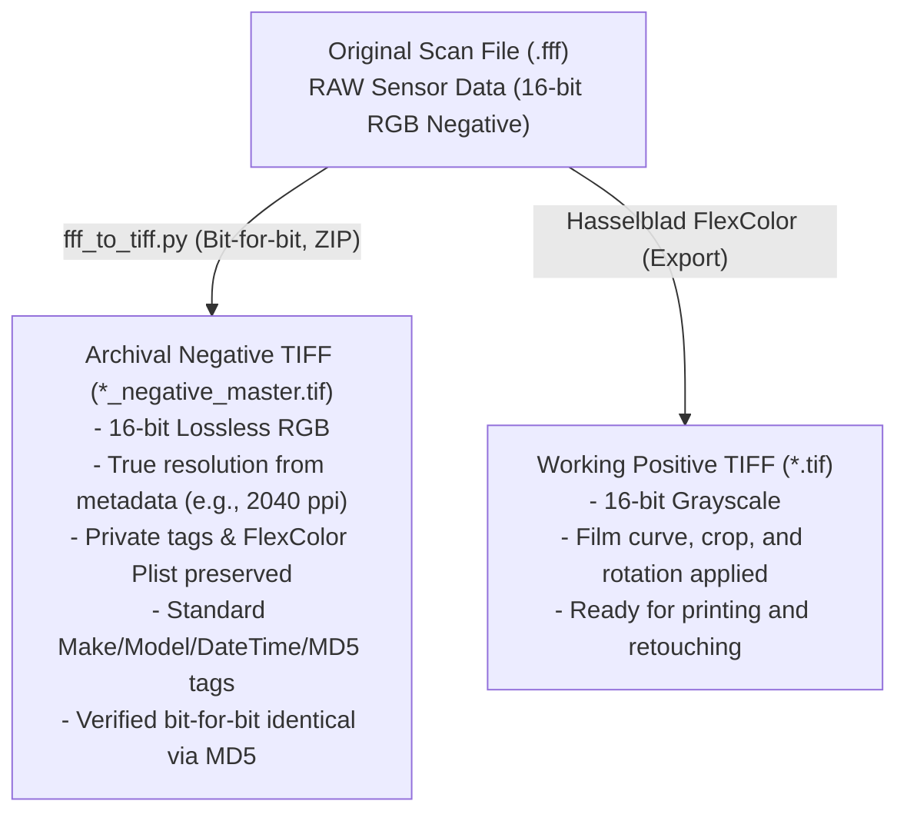

# Hasselblad / Imacon Flextight X5: FFF Analysis and Lossless TIFF Conversion

This repository documents the technical analysis of proprietary **.fff** (3F – *Flexible File Format*) files produced by the **Hasselblad / Imacon Flextight X5** virtual drum scanner for 4x5 negatives. It provides tools for their **standard lossless archiving** and for extracting the developed positive rendering from Hasselblad FlexColor.

---

## 1. Anatomy of the .fff Format (Hasselblad 3F)

Low-level inspection of the `.fff` file reveals that it is internally a standard **Big-Endian TIFF (`MM`, Magic 42)** container with the following architecture:

### Primary Image (IFD #0)
- **Resolution:** e.g., 7991 × 10120 pixels (~80.8 megapixels at 2040 ppi for 4x5 format).
- **Color space:** 3-channel RGB (even for black-and-white film).
- **Bit depth:** 16 bits per channel (samples stored as unsigned big-endian integers `>u2`).
- **Effective sensor dynamic range:** **14 native bits** padded to 16 bits (all values are exact multiples of 4; the 2 least significant bits are always `0`).
- **Raw payload:** **Uninverted negative** image data without any compression (a single continuous byte strip = W × H × 3 × 2).
- **Multi-channel data in B&W negatives:** Channels R, G, and B record slight variations from the 3-line trilinear CCD sensor (mean deviation of ~250–280 levels across channels). Directly converting the source to grayscale would discard native sensor information; the archival master must therefore remain 3-channel RGB.

### Hasselblad / Imacon Proprietary Tags and Metadata
FlexColor development parameters **do not alter the raw sensor pixels**; instead, they are recorded as non-destructive recipes within private TIFF tags:

| Tag / Directory | Name | Description |
|---|---|---|
| `33723` | **IPTC** | Standard IPTC metadata (byline/author, scan date/time, caption/title, etc.). |
| `34152` | **IPTC Copy** | Secondary copy of the IPTC block managed by Imacon. |
| `34377` | **Photoshop IRB** | Photoshop Image Resource Blocks (8BIM) containing IPTC and resolution data. |
| `46277` | **Imacon Scan Info** | Hardware scanner info, calibration, and target profiles. |
| `46279` | **Imacon Scanner ID** | FlexColor software version and scanner hardware serial number. |
| `50457` | **FlexColor Plist** | Apple Property List (XML) containing **all adjustment sets**: gradation curves, histogram, color cast removal, rotation (90°), crop, and color profiles. |
| `50458` | **Imacon RGB Thumb** | Embedded 8-bit RGB preview thumbnail. |
| *(External Directories)* | **IFD #1 / #2** | Sub-IFDs appended to the tail of the original `.fff` file containing downscaled preview thumbnails (8-bit and 16-bit). These are not replicated in the master TIFF as they are redundant (the original thumbnail is already preserved in tag `50458`). |

---

## 2. Archival Strategy: Archival Master vs. Working Positive

Proper digital preservation requires decoupling the **archival master** from the **rendered / interpreted positive**:



1. **Archival Negative TIFF (`*_negative_master.tif`)**:
   - **100% Lossless:** Raw 16-bit RGB pixel data is copied byte-for-byte without any alteration.
   - **Lossless Compression (Deflate/ZIP + Horizontal Predictor):** Reduces file size by approximately 25–30% while preserving strict bit-for-bit integrity.
   - **Long-term Compatibility:** Open and editable in any standard imaging software (Photoshop, Lightroom, RawTherapee, Negative Lab Pro), even if the FlexColor runtime environment becomes obsolete.
   - **Standard Metadata Automatically Populated:**
     - `ImageDescription` (tag 270): Records source filename, exact raw pixel MD5 checksum, effective ppi, active FlexColor setup name, and ISO conversion timestamp.
     - `Make` (tag 271): `Hasselblad`.
     - `Model` (tag 272): `Flextight X5`.
     - `DateTime` (tag 306): Original scan timestamp extracted from IPTC records `2:55` and `2:60`/`2:56`.
   - **Preserved Private Tags:** Complete byte-for-byte copy of Imacon/FlexColor blocks, including the plist `50457` holding the complete adjustment history.

2. **Working Positive TIFF (`*.tif`)**:
   - Exported directly via **FlexColor**.
   - **16-bit Grayscale** format (maximum continuous tonal range without banding/posterization).
   - Color inversion, rotation, framing crop, and custom contrast curve fully rendered.

---

## 3. Using the `fff_to_tiff.py` Script

The [`fff_to_tiff.py`](fff_to_tiff.py) script automates the conversion process with built-in safety verifications.

### Prerequisites
Install the required Python dependencies:
```powershell
pip install numpy tifffile imagecodecs pytest
```

### CLI Syntax
```powershell
# Single conversion (automatically generates NAME_negative_master.tif)
python fff_to_tiff.py "scan.fff"

# Specify a custom output file
python fff_to_tiff.py "scan.fff" -o "output_master.tif"

# Safely overwrite an existing master file
python fff_to_tiff.py "scan.fff" -o "output_master.tif" --force

# Custom strip height for compression (default: 64 rows)
python fff_to_tiff.py "scan.fff" --rows-per-strip 128
```

---

## 4. Technical Architecture and Safety Mechanisms

The converter is engineered for preservation workflows where data corruption, accidental file loss, or silent degradation cannot be tolerated. Below is a detailed technical analysis of the core mechanisms implemented in [`fff_to_tiff.py`](fff_to_tiff.py).

### 4.1. Source Collision Protection

Archival master generation must guarantee under all circumstances that original `.fff` raw scans are never overwritten or mutated, even in the event of user error on the command line.

#### Code Implementation ([`fff_to_tiff.py#L125-L133`](fff_to_tiff.py#L125-L133)):
```python
src = os.path.abspath(args.input)
dst = os.path.abspath(args.output or os.path.splitext(src)[0] + '_negative_master.tif')

# Prevent overwriting the source file even when --force is passed.
if src == dst or (os.path.exists(dst) and os.path.samefile(src, dst)):
    sys.exit(f'refusing to overwrite source file: {src}')
if os.path.exists(dst) and not args.force:
    sys.exit(f'output exists: {dst} (use --force to overwrite)')
```

#### How It Works:
- **Path Canonicalization:** Both `src` and `dst` are resolved to absolute canonical paths using `os.path.abspath()`, neutralizing relative path tricks (such as `./scan.fff` vs `scan.fff` or `../folder/scan.fff`).
- **Dual Identity Check:**
  1. String comparison (`src == dst`) catches direct name collisions.
  2. Filesystem inode/device check (`os.path.samefile(src, dst)`) compares device numbers (`st_dev`) and inode/file index numbers (`st_ino`). This prevents overwrites via symbolic links, hard links, or Windows NTFS junctions/aliases.
- **Strict Precedence over `--force`:** The collision check precedes the check for `args.force`. As a result, `--force` can overwrite a preexisting output file, but it will **never** force an overwrite of the source file.
- **Read-Only Access:** The source file is opened exclusively with mode `'rb'` (`open(src, 'rb')`), guaranteeing that write buffers are never attached to the source descriptor.

---

### 4.2. Two-Tier Post-Write Verification

Writing a compressed TIFF file involves predictive transforms and Deflate encoding. To guarantee that compression artifacts or library errors never alter pixel values or metadata, the script performs a mandatory two-tier validation on the newly written file before finalizing it.

#### Code Implementation ([`fff_to_tiff.py#L242-L280`](fff_to_tiff.py#L242-L280)):
```python
# --- verification ----------------------------------------------------------------
with tifffile.TiffFile(tmp) as tf:
    page = tf.pages[0]
    out = page.asarray()
    problems: list[str] = []
    if out.shape != pixels.shape or out.dtype.itemsize != 2:
        problems.append(f'shape/dtype mismatch {out.shape} {out.dtype}')
    elif not np.array_equal(out, pixels):
        problems.append('pixel data differs')
    out_be = np.ascontiguousarray(out, dtype=bo + 'u2')
    out_md5 = hashlib.md5(memoryview(out_be)).hexdigest()
    if out_md5 != src_md5:
        problems.append('pixel MD5 differs')
    for code in COPY_TAGS:
        if code in tags:
            t_tag = page.tags.get(code)
            if t_tag is None:
                problems.append(f'tag {code} missing')
                continue
            val = t_tag.value
            orig_typ, orig_cnt, orig_raw = tags[code]
            if isinstance(val, (bytes, bytearray)):
                got = bytes(val)
            elif isinstance(val, str):
                got = val.encode('latin1') + b'\x00'
            else:
                fmt = TIFF_TYPES[orig_typ][0]
                vals = list(val) if isinstance(val, (tuple, list)) else [val]
                got = struct.pack(bo + fmt * orig_cnt, *vals)
            if got != orig_raw:
                problems.append(f'tag {code} differs')
```

#### How It Works:
- **Tier 1: Array-Level and In-Memory Comparison:**
  - Reads back the written image using `tifffile.TiffFile(tmp).pages[0].asarray()`.
  - Verifies matrix dimensions (`out.shape == pixels.shape`) and bit depth (`out.dtype.itemsize == 2`, corresponding to 16 bits per sample).
  - Evaluates `np.array_equal(out, pixels)` across all samples (e.g., $7991 \times 10120 \times 3 \approx 242.6 \times 10^6$ values), ensuring zero difference in unpacked numerical representation.
- **Tier 2: Cryptographic Payload Hash Matching:**
  - Standardizes memory layout into a C-contiguous array in native file byte order (`np.ascontiguousarray(out, dtype=bo + 'u2')`).
  - Calculates the MD5 digest over the raw pixel buffer via `hashlib.md5(memoryview(out_be)).hexdigest()`.
  - Asserts that `out_md5 == src_md5`, where `src_md5` was computed directly from the source file strips prior to decompression.
- **Private Metadata Tag Verification:**
  - Iterates over all tags defined in `COPY_TAGS` (IPTC, Photoshop IRB, Imacon scan info, FlexColor settings plist `50457`, etc.).
  - Serializes read-back tag values back to raw bytes according to TIFF type specifications (`struct.pack`) and checks them byte-for-byte against the original binary values (`got != orig_raw`).
- **Failure Escalation:** Any discrepancy appends to `problems`, which aborts the process via `RuntimeError`, triggering the atomic cleanup handler.

---

### 4.3. Atomic Writing and Failure Cleanup

To prevent partial or corrupt files from remaining on disk during power loss, process termination, full disk errors, or verification failures, all file writes use atomic staging and cleanup semantics.

#### Code Implementation ([`fff_to_tiff.py#L231-L290`](fff_to_tiff.py#L231-L290)):
```python
# --- write to a temporary file, verify, then rename ----------------------------------
tmp = dst + '.partial'
try:
    tifffile.imwrite(
        tmp, pixels, byteorder=bo, photometric='rgb', planarconfig='contig',
        compression='zlib', compressionargs={'level': 6}, predictor=True,
        rowsperstrip=args.rows_per_strip,
        resolution=(dpi, dpi), resolutionunit='INCH',
        description=description, software=f'fff_to_tiff.py (tifffile {tifffile.__version__})',
        datetime=datetime_str, extratags=extratags, metadata=None,
    )

    # --- verification runs on tmp ---
    if problems:
        raise RuntimeError('VERIFICATION FAILED, output discarded: ' + '; '.join(problems))
    os.replace(tmp, dst)
except BaseException as exc:
    if os.path.exists(tmp):
        try:
            os.remove(tmp)
        except OSError:
            pass
    if isinstance(exc, RuntimeError):
        sys.exit(str(exc))
    raise
```

#### How It Works:
- **Isolated Staging (`.partial`):** All output is written to a temporary sibling file `tmp = dst + '.partial'`. The target destination `dst` remains untouched and unmodified until the new file has completely passed verification.
- **Atomic Promotion (`os.replace`):** Once verification succeeds, `os.replace(tmp, dst)` renames the staging file to the final destination. On POSIX systems and modern Windows NT systems (via `MoveFileExW` with `MOVEFILE_REPLACE_EXISTING`), this operation is atomic at the filesystem level. External processes will never observe an incomplete or half-written file.
- **`BaseException` Cleanup Boundary:** The entire write and verification sequence is enclosed in a `try...except BaseException` block. Unlike standard `except Exception`, this captures:
  - System aborts and interruptions (`KeyboardInterrupt` / Ctrl+C).
  - Out-of-memory or out-of-disk exceptions (`OSError`).
  - Verification rejections (`RuntimeError`).
- **Orphan File Removal:** If any error is caught, `os.remove(tmp)` immediately purges the staging `.partial` file from disk, guaranteeing zero residue from failed runs.

---

### 4.4. Cross-Platform and Endianness Support

TIFF containers can be encoded in either Motorola Big-Endian (`MM`) or Intel Little-Endian (`II`) format. While Flextight scanners produce Big-Endian `.fff` files, robust tooling must handle both formats transparently across any host operating system and CPU architecture.

#### Code Implementation:

Header detection and dynamic IFD unpack ([`fff_to_tiff.py#L62-L87`](fff_to_tiff.py#L62-L87)):
```python
def read_ifd0(path: str) -> tuple[str, dict[int, TagEntry]]:
    with open(path, 'rb') as f:
        hdr = _read_exact(f, 8)
        if hdr[:2] not in (b'MM', b'II'):
            raise ValueError('not a TIFF-based file')
        bo = '>' if hdr[:2] == b'MM' else '<'
        magic, off = struct.unpack(bo + 'HI', hdr[2:8])
        if magic != 42:
            raise ValueError(f'unsupported TIFF variant (magic {magic})')
        f.seek(off)
        n = struct.unpack(bo + 'H', _read_exact(f, 2))[0]
        entries = [_read_exact(f, 12) for _ in range(n)]
        # ... unpacked dynamically with format strings parameterized by bo ...
```

Buffer reconstruction, writing, and verification ([`fff_to_tiff.py#L167`](fff_to_tiff.py#L167), [`#L234`](fff_to_tiff.py#L234), [`#L251`](fff_to_tiff.py#L251)):
```python
# NumPy typed directly with the container's endianness:
pixels = np.frombuffer(raw, dtype=bo + 'u2').reshape(height, width, 3)

# Preserving container byte order during Deflate compression:
tifffile.imwrite(tmp, pixels, byteorder=bo, ...)

# Cross-platform hash alignment:
out_be = np.ascontiguousarray(out, dtype=bo + 'u2')
out_md5 = hashlib.md5(memoryview(out_be)).hexdigest()
```

#### How It Works:
- **Dynamic Header Parsing:** Inspects the first 2 bytes of the container: `b'MM'` sets `bo = '>'` (big-endian), and `b'II'` sets `bo = '<'` (little-endian).
- **Parameterized Struct Unpacking:** All subsequent binary parsing throughout IFD directory entries parameterizes format strings with `bo` (e.g., `bo + 'HI'`, `bo + 'HHI'`, `bo + fmt * cnt`). Hardcoded endianness assumptions are avoided.
- **Direct NumPy Endian Types:** Array buffers are mapped using `dtype=bo + 'u2'`, which indicates unsigned 16-bit integers (`uint16`) respecting the file's native byte order (`>u2` or `<u2`).
- **Native Container Preservation:** When outputting the TIFF, `byteorder=bo` preserves the source file's original byte order, preventing unnecessary byte swapping.
- **Deterministic Hashing:** Casting to `bo + 'u2'` before MD5 calculation guarantees that hash comparisons remain identical whether executed on x86-64 (little-endian), ARM64, or big-endian architectures.

---

### 4.5. Zero-Copy and Low Memory Footprint

A 4x5 sheet film scan at 2040 ppi yields an uncompressed frame of $7991 \times 10120 \times 3 \times 2 \approx 485.2\text{ MB}$. Naive image processing scripts frequently duplicate arrays during type conversion, hashing, and compression, creating memory spikes exceeding 2–3 GB that can crash systems with limited RAM.

#### Code Implementation:

Zero-copy ndarray instantiation ([`fff_to_tiff.py#L161-L167`](fff_to_tiff.py#L161-L167)):
```python
# --- read source pixels (read-only) and hash the raw bytes exactly as stored ----------
raw = bytearray()
with open(src, 'rb') as f:
    for o, c in zip(offsets, counts):
        f.seek(o)
        raw += _read_exact(f, c)
src_md5 = hashlib.md5(raw).hexdigest()
pixels = np.frombuffer(raw, dtype=bo + 'u2').reshape(height, width, 3)
```

Direct buffer hashing via `memoryview` ([`fff_to_tiff.py#L251-L252`](fff_to_tiff.py#L251-L252)):
```python
out_be = np.ascontiguousarray(out, dtype=bo + 'u2')
out_md5 = hashlib.md5(memoryview(out_be)).hexdigest()
```

Striped compression streaming ([`fff_to_tiff.py#L236`](fff_to_tiff.py#L236)):
```python
tifffile.imwrite(
    ...,
    rowsperstrip=args.rows_per_strip,  # default: 64 rows
    ...
)
```

#### How It Works:
- **Zero-Copy View with `np.frombuffer`:** Rather than allocating a new memory buffer when parsing pixel data, `np.frombuffer(raw, dtype=bo + 'u2')` creates a NumPy ndarray wrapper directly over the existing byte buffer `raw`. The `reshape` operation is a metadata-only stride operation, resulting in $O(1)$ additional memory allocation.
- **Zero-Copy Hashing with `memoryview`:** In standard Python, calculating the MD5 of a NumPy array requires calling `out.tobytes()`, which allocates another duplicate ~485 MB byte string on the Python heap. By using `memoryview(out_be)`, the script exposes the array's underlying C-contiguous buffer directly to OpenSSL's C-level hashing routines via the Python Buffer Protocol with **zero heap memory allocation**.
- **Streaming Strip Compression:** Rather than encoding the entire ~485 MB image in one massive block, `rowsperstrip=64` divides the image into horizontal bands ($64 \times 7991 \times 3 \times 2 \approx 3.07\text{ MB}$ per strip). The Deflate compressor processes and flushes each strip sequentially, maintaining a predictable and low working memory ceiling throughout the compression phase.

---

## 5. Test Suite (`pytest`)

Automated unit tests are provided in [`test_fff_to_tiff.py`](test_fff_to_tiff.py):

```powershell
python -m pytest -v
```

Included test cases:
1. `test_end_to_end_lossless_conversion`: Full round-trip verification, DPI extraction from plist, and private tag preservation.
2. `test_refuses_to_overwrite_source_file`: Confirms `--force` cannot overwrite the source `.fff` file.
3. `test_truncated_file_raises_value_error`: Detection of truncated files or out-of-bounds offsets (`_read_exact`).
4. `test_corrupt_flexcolor_plist_falls_back_gracefully`: Graceful degradation if metadata plist is malformed.
5. `test_little_endian_conversion`: Validates little-endian (`<`) byte order handling and MD5 integrity.
6. `test_partial_file_cleaned_up_on_failure`: Ensures incomplete `.partial` files are deleted on runtime exceptions.

---

## 6. License

Released under an open-source license for archiving and processing Hasselblad/Imacon Flextight scanner files.
