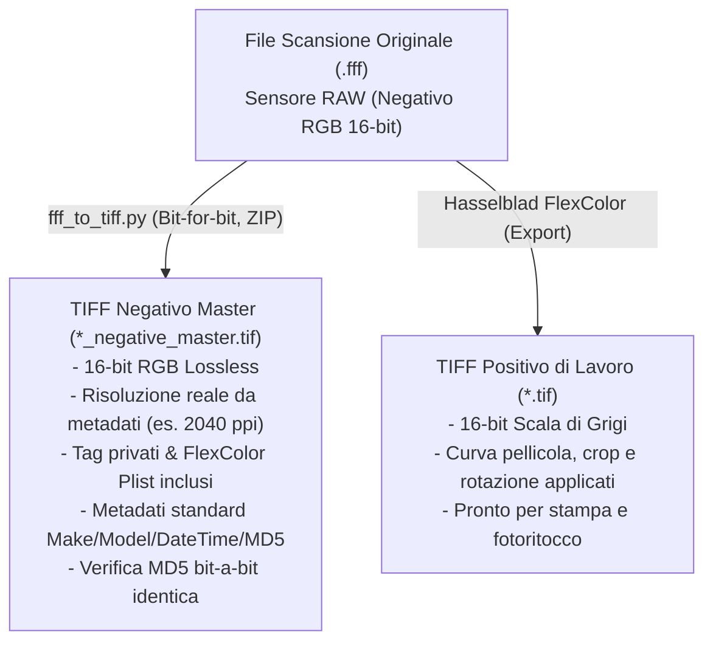

# Hasselblad / Imacon Flextight X5: Analisi FFF e Conversione Lossless in TIFF

Questo archivio documenta l'analisi tecnica dei file proprietari **.fff** (3F - *Flexible File Format*) generati dallo scanner a tamburo virtuale **Hasselblad / Imacon Flextight X5** per negativi 4x5, e fornisce gli strumenti per la loro **archiviazione lossless standard** e l'estrazione della resa positiva sviluppata con Hasselblad FlexColor.

---

## 1. Anatomia del formato .fff (Hasselblad 3F)

L'analisi a basso livello del file `.fff` evidenzia che si tratta internamente di un container standard **TIFF Big-Endian (`MM`, Magic 42)** con la seguente architettura:

### Immagine Principale (IFD #0)
- **Risoluzione:** ad es. 7991 × 10120 pixel (~80,8 Megapixel a 2040 ppi per formato 4x5).
- **Spazio colore:** RGB a 3 canali (anche per pellicole bianco e nero).
- **Profondità colore:** 16 bit per canale (campioni memorizzati come interi senza segno `>u2`).
- **Dinamica effettiva del sensore:** **14 bit nativi** estesi su 16 bit (tutti i valori sono multipli esatti di 4, i 2 bit meno significativi sono sempre a `0`).
- **Dati grezzi:** Immagine **negativa non invertita**, senza alcuna compressione (un unico strip continuo di byte = W × H × 3 × 2).
- **Multi-canale nei negativi B&W:** I canali R, G e B registrano risposte leggermente diverse del sensore CCD a 3 linee (scostamento medio di ~250–280 livelli tra canali). Convertire direttamente il file sorgente in scala di grigi causerebbe una perdita di informazione nativa; la copia master deve quindi rimanere RGB a 3 canali.

### Metadati e Tag Proprietari Hasselblad/Imacon
I parametri di sviluppo di FlexColor **non alterano i pixel grezzi**, ma vengono salvati come ricette all'interno di tag TIFF privati:

| Tag / Directory | Nome | Descrizione |
|---|---|---|
| `33723` | **IPTC** | Metadati IPTC standard (credit/autore, data e ora di scansione, caption/titolo, ecc.). |
| `34152` | **IPTC Copy** | Copia secondaria del blocco IPTC gestita da Imacon. |
| `34377` | **Photoshop IRB** | Risorse immagine Photoshop (8BIM) contenenti IPTC e risoluzione. |
| `46277` | **Imacon Scan Info** | Informazioni hardware, calibrazione e profili target. |
| `46279` | **Imacon Scanner ID** | Versione software FlexColor e numero di serie dell'hardware scanner. |
| `50457` | **FlexColor Plist** | XML Apple Property List contenente **tutti i set di regolazioni**: curve di gradazione, istogramma, rimozione dominante, rotazione (90°), crop e profili colore. |
| `50458` | **Imacon RGB Thumb** | Thumbnail preview RGB a 8 bit incorporata. |
| *(Directory esterne)* | **IFD #1 / #2** | Sub-IFD concatenati in coda al file `.fff` originale contenenti anteprime ridotte (8 bit e 16 bit). Non vengono replicati nel master TIFF in quanto ridondanti (la miniatura originale è già preservata nel tag `50458`). |

---

## 2. Strategia di Archiviazione: Master vs Positivo di Lavoro

Una corretta conservazione digitale richiede di separare la componente **master d'archivio** dalla componente **positivata/interpretata**:



1. **TIFF Negativo Master (`*_negative_master.tif`)**:
   - **Lossless al 100%:** I pixel grezzi 16-bit RGB vengono copiati byte per byte senza modifiche.
   - **Compressione senza perdita (Deflate/ZIP + Horizontal Predictor):** Riduce le dimensioni del file di circa il 25–30% mantenendo intatta la corrispondenza bit-a-bit.
   - **Compatibilità a lungo termine:** Leggibile da qualsiasi software (Photoshop, Lightroom, RawTherapee, Negative Lab Pro) anche se l'ambiente FlexColor non dovesse più essere accessibile in futuro.
   - **Metadati standard compilati automaticamente:**
     - `ImageDescription` (tag 270): documenta il nome del file sorgente, l'impronta MD5 esatta dei pixel grezzi, i ppi effettivi, il nome del set di regolazioni FlexColor attivo e il timestamp ISO di conversione.
     - `Make` (tag 271): `Hasselblad`.
     - `Model` (tag 272): `Flextight X5`.
     - `DateTime` (tag 306): data e ora originali di scansione estratte dai record IPTC `2:55` e `2:60`/`2:56`.
   - **Tag privati preservati:** Copia integrale dei blocchi Imacon/FlexColor inclusa la plist `50457` con tutta la cronologia dei settaggi.

2. **TIFF Positivo di Lavoro (`*.tif`)**:
   - Esportato direttamente tramite **FlexColor**.
   - Formato **16-bit Grayscale** (massima dinamica tonale continua senza posterizzazione).
   - Inversione colore, rotazione, crop dell'inquadratura e curva di contrasto personalizzata già renderizzati.

---

## 3. Utilizzo dello Script `fff_to_tiff.py`

Lo script [`fff_to_tiff.py`](fff_to_tiff.py) esegue la conversione automatizzata con verifica di sicurezza.

### Prerequisiti
Installare le dipendenze Python richieste:
```powershell
pip install numpy tifffile imagecodecs pytest
```

### Sintassi CLI
```powershell
# Conversione singola (genera automaticamente NOME_negative_master.tif)
python fff_to_tiff.py "scansione.fff"

# Specifica del file di output
python fff_to_tiff.py "scansione.fff" -o "output_master.tif"

# Sovrascrittura controllata di un master esistente
python fff_to_tiff.py "scansione.fff" -o "output_master.tif" --force

# Personalizzazione dell'altezza degli strip compressi (predefinito: 64 righe)
python fff_to_tiff.py "scansione.fff" --rows-per-strip 128
```

### Caratteristiche di Sicurezza Implementate
- **Protezione anticollisione sorgente:** Impedisce la sovrascrittura accidentale del file `.fff` sorgente anche se passato come destinazione con `--force`.
- **Verifica post-scrittura a doppio livello:** Rilettura immediata del file TIFF generato, confronto con la matrice numpy sorgente e calcolo del checksum MD5.
- **Scrittura atomica:** L'immagine viene scritta temporaneamente come `.tif.partial`; se la verifica o la scrittura fallisce per qualsiasi motivo (es. disco pieno o interruzione), il file incompleto viene rimosso immediatamente dal disco.
- **Supporto multi-piattaforma ed Endianness:** Supporto nativo sia per file Big-Endian (`MM`) che Little-Endian (`II`).
- **Zero-copy e memoria ottimizzata:** Utilizzo di `memoryview` per l'hashing MD5 e passaggio diretto dei buffer per contenere l'uso della RAM durante l'elaborazione di scansioni di grande formato.

---

## 4. Test Suite (`pytest`)

I test unitari automatizzati sono disponibili in [`test_fff_to_tiff.py`](test_fff_to_tiff.py):

```powershell
pytest -v
```

Casi di test inclusi:
1. `test_end_to_end_lossless_conversion`: Roundtrip completo, verifica DPI da plist e presenza tag privati.
2. `test_refuses_to_overwrite_source_file`: Controllo di rifiuto sovrascrittura del sorgente con `--force`.
3. `test_truncated_file_raises_value_error`: Rilevamento file troncati o offset oltre EOF (`_read_exact`).
4. `test_corrupt_flexcolor_plist_falls_back_gracefully`: Tolleranza ad anomalie nel plist dei metadati.
5. `test_little_endian_conversion`: Verifica del flusso little-endian (`<`) e integrità dell'MD5.
6. `test_partial_file_cleaned_up_on_failure`: Pulizia garantita dei file temporanei `.partial` in caso di eccezioni a runtime.

---

## 5. Licenza

Distribuito con licenza open source per la conservazione e l'elaborazione dei file di scansione Hasselblad/Imacon Flextight.
