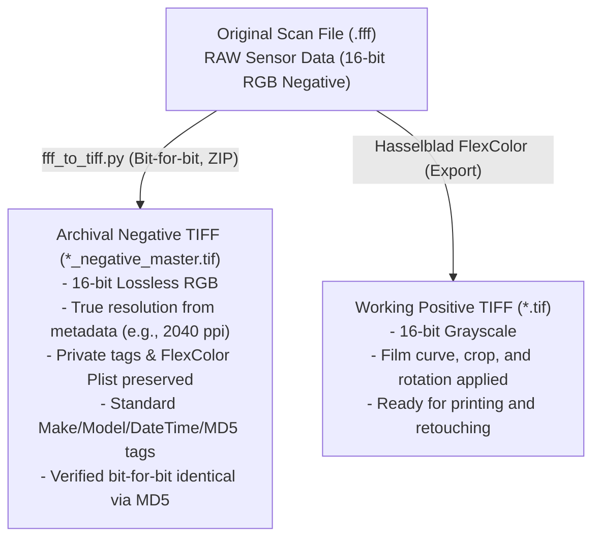

# Hasselblad / Imacon Flextight X5: FFF Analysis and Lossless TIFF Conversion

This repository documents the technical analysis of proprietary **.fff** (3F – *Flexible File Format*) files produced by the **Hasselblad / Imacon Flextight X5** virtual drum scanner for 4x5 negatives. It provides tools for their **standard lossless archiving** and for extracting the developed positive rendering from Hasselblad FlexColor.

---

## 1. Anatomy of the .fff Format (Hasselblad 3F)

Low-level inspection of the `.fff` file reveals that it is internally a standard **Big-Endian TIFF (`MM`, Magic 42)** container with the following architecture:

### Primary Image (IFD #0)
- **Resolution:** e.g., 7991 × 10120 pixels (~80.8 megapixels at 2040 ppi for 4x5 format).
- **Color space:** 3-channel RGB (even for black-and-white film).
- **Bit depth:** 16 bits per channel (samples stored as unsigned big-endian integers `>u2`).
- **Effective sensor dynamic range:** **14 native bits** padded to 16 bits (all values are exact multiples of 4; the 2 least significant bits are always `0`).
- **Raw payload:** **Uninverted negative** image data without any compression (a single continuous byte strip = W × H × 3 × 2).
- **Multi-channel data in B&W negatives:** Channels R, G, and B record slight variations from the 3-line trilinear CCD sensor (mean deviation of ~250–280 levels across channels). Directly converting the source to grayscale would discard native sensor information; the archival master must therefore remain 3-channel RGB.

### Hasselblad / Imacon Proprietary Tags and Metadata
FlexColor development parameters **do not alter the raw sensor pixels**; instead, they are recorded as non-destructive recipes within private TIFF tags:

| Tag / Directory | Name | Description |
|---|---|---|
| `33723` | **IPTC** | Standard IPTC metadata (byline/author, scan date/time, caption/title, etc.). |
| `34152` | **IPTC Copy** | Secondary copy of the IPTC block managed by Imacon. |
| `34377` | **Photoshop IRB** | Photoshop Image Resource Blocks (8BIM) containing IPTC and resolution data. |
| `46277` | **Imacon Scan Info** | Hardware scanner info, calibration, and target profiles. |
| `46279` | **Imacon Scanner ID** | FlexColor software version and scanner hardware serial number. |
| `50457` | **FlexColor Plist** | Apple Property List (XML) containing **all adjustment sets**: gradation curves, histogram, color cast removal, rotation (90°), crop, and color profiles. |
| `50458` | **Imacon RGB Thumb** | Embedded 8-bit RGB preview thumbnail. |
| *(External Directories)* | **IFD #1 / #2** | Sub-IFDs appended to the tail of the original `.fff` file containing downscaled preview thumbnails (8-bit and 16-bit). These are not replicated in the master TIFF as they are redundant (the original thumbnail is already preserved in tag `50458`). |

---

## 2. Archival Strategy: Archival Master vs. Working Positive

Proper digital preservation requires decoupling the **archival master** from the **rendered / interpreted positive**:



1. **Archival Negative TIFF (`*_negative_master.tif`)**:
   - **100% Lossless:** Raw 16-bit RGB pixel data is copied byte-for-byte without any alteration.
   - **Lossless Compression (Deflate/ZIP + Horizontal Predictor):** Reduces file size by approximately 25–30% while preserving strict bit-for-bit integrity.
   - **Long-term Compatibility:** Open and editable in any standard imaging software (Photoshop, Lightroom, RawTherapee, Negative Lab Pro), even if the FlexColor runtime environment becomes obsolete.
   - **Standard Metadata Automatically Populated:**
     - `ImageDescription` (tag 270): Records source filename, exact raw pixel MD5 checksum, effective ppi, active FlexColor setup name, and ISO conversion timestamp.
     - `Make` (tag 271): `Hasselblad`.
     - `Model` (tag 272): `Flextight X5`.
     - `DateTime` (tag 306): Original scan timestamp extracted from IPTC records `2:55` and `2:60`/`2:56`.
   - **Preserved Private Tags:** Complete byte-for-byte copy of Imacon/FlexColor blocks, including the plist `50457` holding the complete adjustment history.

2. **Working Positive TIFF (`*.tif`)**:
   - Exported directly via **FlexColor**.
   - **16-bit Grayscale** format (maximum continuous tonal range without banding/posterization).
   - Color inversion, rotation, framing crop, and custom contrast curve fully rendered.

---

## 3. Using the `fff_to_tiff.py` Script

The [`fff_to_tiff.py`](fff_to_tiff.py) script automates the conversion process with built-in safety verifications.

### Prerequisites
Install the required Python dependencies:
```powershell
pip install numpy tifffile imagecodecs pytest
```

### CLI Syntax
```powershell
# Single conversion (automatically generates NAME_negative_master.tif)
python fff_to_tiff.py "scan.fff"

# Specify a custom output file
python fff_to_tiff.py "scan.fff" -o "output_master.tif"

# Safely overwrite an existing master file
python fff_to_tiff.py "scan.fff" -o "output_master.tif" --force

# Custom strip height for compression (default: 64 rows)
python fff_to_tiff.py "scan.fff" --rows-per-strip 128
```

---

## 4. Technical Architecture and Safety Mechanisms

The converter is engineered for preservation workflows where data corruption, accidental file loss, or silent degradation cannot be tolerated. Below is a detailed technical analysis of the core mechanisms implemented in [`fff_to_tiff.py`](fff_to_tiff.py).

### 4.1. Source Collision Protection

Archival master generation must guarantee under all circumstances that original `.fff` raw scans are never overwritten or mutated, even in the event of user error on the command line.

#### Code Implementation ([`fff_to_tiff.py#L139-L151`](fff_to_tiff.py#L139-L151)):
```python
src = os.path.abspath(args.input)
dst = os.path.abspath(args.output or os.path.splitext(src)[0] + '_negative_master.tif')

# samefile() below raises FileNotFoundError on a missing source; fail clearly instead.
if not os.path.exists(src):
    sys.exit(f'input not found: {src}')
if not os.path.isfile(src):
    sys.exit(f'input is not a regular file: {src}')
# Prevent overwriting the source file even when --force is passed.
if src == dst or (os.path.exists(dst) and os.path.samefile(src, dst)):
    sys.exit(f'refusing to overwrite source file: {src}')
if os.path.exists(dst) and not args.force:
    sys.exit(f'output exists: {dst} (use --force to overwrite)')
```

#### How It Works:
- **Path Normalization:** Both `src` and `dst` are converted to absolute, normalized paths with `os.path.abspath()`, so spellings such as `./scan.fff`, `scan.fff` or `../folder/scan.fff` compare equal. `abspath()` does not resolve symbolic links; that case is handled by the identity check below.
- **Source Existence and Type Check:** `os.path.samefile()` calls `os.stat()` on both paths and raises `FileNotFoundError` if the source is missing. Explicit `os.path.exists(src)` and `os.path.isfile(src)` guards report missing paths (`input not found`) and non-file paths such as directories (`input is not a regular file`) cleanly instead of raising a traceback.
- **Dual Identity Check:**
  1. String comparison (`src == dst`) catches direct name collisions.
  2. `os.path.samefile(src, dst)` compares the device number (`st_dev`) and inode / NTFS file index (`st_ino`) of both paths. This catches aliases that differ as strings: symbolic links, hard links, junctions, and case-only differences on case-insensitive filesystems.
- **Strict Precedence over `--force`:** The collision check runs before `args.force` is consulted. `--force` can replace a preexisting output file, but it can **never** target the source file.
- **Read-Only Access:** The source file is only ever opened with mode `'rb'`, so no write handle to it is ever created.

---

### 4.2. Two-Tier Post-Write Verification

Writing a compressed TIFF involves a predictor transform and Deflate encoding. To guarantee that neither the encoder nor the TIFF writer alters pixel values or metadata, the newly written file is decoded again and checked against the source before it is promoted to its final name.

#### Code Implementation ([`fff_to_tiff.py#L273-L335`](fff_to_tiff.py#L273-L335)):
```python
with tifffile.TiffFile(tmp) as tf:
    page = tf.pages[0]
    problems: list[str] = []
    if page.shape != pixels.shape or page.dtype is None or page.dtype.itemsize != 2:
        problems.append(f'shape/dtype mismatch {page.shape} {page.dtype}')
    else:
        md5 = hashlib.md5()
        src_dtype = np.dtype(bo + 'u2')
        pixels_equal = True
        y = 0
        for segment, index, shape in page.segments(
            sort=True, buffersize=VERIFY_READ_BUFFER
        ):
            if segment is None:
                problems.append(f'strip at row {y} could not be decoded')
                break
            rows = np.ascontiguousarray(segment.reshape(shape[-3:]), dtype=src_dtype)
            n = rows.shape[0]
            if index[-3] != y or y + n > height:
                problems.append(f'unexpected strip layout at row {y}')
                break
            if pixels_equal and not np.array_equal(rows, pixels[y:y + n]):
                pixels_equal = False
            md5.update(rows)
            y += n
        else:
            if y != height:
                problems.append(f'decoded {y} rows, expected {height}')
        if not pixels_equal:
            problems.append('pixel data differs')
        if md5.hexdigest() != src_md5:
            problems.append('pixel MD5 differs')
    for code in COPY_TAGS:
        ...  # byte-for-byte tag comparison, see below
if problems:
    raise RuntimeError('VERIFICATION FAILED, output discarded: ' + '; '.join(problems))
```

#### How It Works:
- **Structural Check:** The output page must report the same `(height, width, 3)` shape as the source and a 2-byte (16-bit) sample type before any pixel is compared.
- **Strip-by-Strip Decoding:** Instead of `page.asarray()`, which materializes a second full-size image, the verifier iterates over `page.segments(sort=True)`. Each iteration yields one decoded strip (Deflate inflated, horizontal predictor undone) together with its pixel row offset (`index[-3]`). The verifier checks that strips arrive contiguously (`index[-3] == y`), never overrun the image, decode successfully, and together cover exactly `height` rows.
- **Tier 1 – Numerical Equality:** Each decoded strip is compared with the matching rows of the source array using `np.array_equal(rows, pixels[y:y + n])`. Across all strips this covers every sample of the image (e.g., $7991 \times 10120 \times 3 \approx 242.6 \times 10^6$ values).
- **Tier 2 – Independent Hash of the Decoded Output:** tifffile decodes into the host's native byte order (little-endian on x86-64/ARM64), while `src_md5` was computed over the source bytes in the file's byte order (`bo`). Each strip is therefore converted to `bo + 'u2'` before being fed to a running `hashlib.md5()`. The final digest must equal `src_md5`, which was computed from the raw source strips before any NumPy processing.
- **Private Metadata Tag Verification:** Every tag in `COPY_TAGS` present in the source (IPTC, Photoshop IRB, Imacon scan info, FlexColor settings plist `50457`, etc.) is read back, re-serialized to raw bytes according to its original TIFF type (`struct.pack`), and compared byte-for-byte with the source bytes (`got != orig_raw`). If a preserved tag has a TIFF type the parser does not understand, [`read_ifd0`](fff_to_tiff.py#L87-L91) raises an error instead of silently dropping it.
- **Failure Escalation:** Any discrepancy is appended to `problems`, the run aborts with `RuntimeError`, and the cleanup handler (§4.3) deletes the staging file.

---

### 4.3. Atomic Writing and Failure Cleanup

The final output path must only ever contain a complete, verified master. All writes are staged in a temporary file that is promoted only after verification succeeds.

#### Code Implementation ([`fff_to_tiff.py#L261-L345`](fff_to_tiff.py#L261-L345)):
```python
tmp = dst + '.partial'
try:
    tifffile.imwrite(
        tmp, pixels, byteorder=bo, photometric='rgb', planarconfig='contig',
        compression='zlib', compressionargs={'level': 6}, predictor=True,
        rowsperstrip=args.rows_per_strip,
        resolution=(dpi, dpi), resolutionunit='INCH',
        description=description, software=f'fff_to_tiff.py (tifffile {tifffile.__version__})',
        datetime=datetime_str, extratags=extratags, metadata=None,
    )

    # --- verification runs on tmp (§4.2) ---
    if problems:
        raise RuntimeError('VERIFICATION FAILED, output discarded: ' + '; '.join(problems))
    os.replace(tmp, dst)
except BaseException as exc:
    if os.path.exists(tmp):
        try:
            os.remove(tmp)
        except OSError:
            pass
    if isinstance(exc, RuntimeError):
        sys.exit(str(exc))
    raise
```

#### How It Works:
- **Isolated Staging (`.partial`):** All output is written to the sibling file `dst + '.partial'`. The destination `dst`, including any existing master being replaced with `--force`, is not touched until verification has passed.
- **Single-Step Promotion (`os.replace`):** After verification, `os.replace(tmp, dst)` renames the staging file over the destination. Because the staging file sits in the same directory, this is a rename within one volume and never a copy. On POSIX this is `rename(2)`, which atomically replaces the target. On Windows, CPython uses `MoveFileExW(..., MOVEFILE_REPLACE_EXISTING)`. On NTFS this is a metadata-only rename in practice, although Windows does not formally document it as atomic.
- **`BaseException` Cleanup Boundary:** The write and verification sequence is wrapped in `try...except BaseException`. Unlike `except Exception`, this also covers `KeyboardInterrupt` (Ctrl+C) and `SystemExit`, in addition to `MemoryError`, disk-full `OSError`s, and verification failures (`RuntimeError`). The `.partial` file is removed and the exception is re-raised. Verification failures are reported as a clean exit message.
- **Limits:** Cleanup runs inside the Python process. A power loss, OS crash, or forced termination (`SIGKILL`, Task Manager "End task") can leave a stale `.partial` file behind. Even then, the final `*_negative_master.tif` is never left half-written, because it only appears after `os.replace` succeeds. Any `.partial` file found on disk is an unverified leftover and can be deleted.

---

### 4.4. Cross-Platform and Endianness Support

TIFF containers can be encoded in either Motorola Big-Endian (`MM`) or Intel Little-Endian (`II`) format. While Flextight scanners produce Big-Endian `.fff` files, robust tooling must handle both formats transparently across any host operating system and CPU architecture.

#### Code Implementation:

Header detection and dynamic IFD unpack ([`fff_to_tiff.py#L71-L99`](fff_to_tiff.py#L71-L99)):
```python
def read_ifd0(path: str) -> tuple[str, dict[int, TagEntry]]:
    with open(path, 'rb') as f:
        hdr = _read_exact(f, 8)
        if hdr[:2] not in (b'MM', b'II'):
            raise ValueError('not a TIFF-based file')
        bo = '>' if hdr[:2] == b'MM' else '<'
        magic, off = struct.unpack(bo + 'HI', hdr[2:8])
        if magic != 42:
            raise ValueError(f'unsupported TIFF variant (magic {magic})')
        f.seek(off)
        n = struct.unpack(bo + 'H', _read_exact(f, 2))[0]
        entries = [_read_exact(f, 12) for _ in range(n)]
        # ... unpacked dynamically with format strings parameterized by bo ...
```

Buffer reconstruction, writing, and verification ([`fff_to_tiff.py#L198`](fff_to_tiff.py#L198), [`#L265`](fff_to_tiff.py#L265), [`#L285`](fff_to_tiff.py#L285), [`#L294`](fff_to_tiff.py#L294)):
```python
# NumPy view typed with the container's endianness:
pixels = np.frombuffer(raw, dtype=bo + 'u2').reshape(height, width, 3)

# Preserving container byte order during Deflate compression:
tifffile.imwrite(tmp, pixels, byteorder=bo, ...)

# Decoded strips (native byte order) converted back to the container byte order before hashing:
src_dtype = np.dtype(bo + 'u2')
rows = np.ascontiguousarray(segment.reshape(shape[-3:]), dtype=src_dtype)
```

#### How It Works:
- **Dynamic Header Parsing:** Inspects the first 2 bytes of the container: `b'MM'` sets `bo = '>'` (big-endian), and `b'II'` sets `bo = '<'` (little-endian).
- **Parameterized Struct Unpacking:** All subsequent binary parsing of IFD entries builds its format strings from `bo` (e.g., `bo + 'HI'`, `bo + 'HHI'`, `bo + fmt * cnt`). There are no hardcoded endianness assumptions.
- **Direct NumPy Endian Types:** The pixel buffer is interpreted with `dtype=bo + 'u2'`, i.e. unsigned 16-bit integers in the file's byte order (`>u2` or `<u2`).
- **Native Container Preservation:** `byteorder=bo` writes the master in the same byte order as the source.
- **Deterministic Hashing:** The source MD5 is taken over the bytes exactly as stored, and the verification MD5 is taken over decoded strips converted back to `bo + 'u2'`. Both digests describe the same byte sequence on any host architecture (x86-64, ARM64, or big-endian).

---

### 4.5. Memory Footprint

A 4x5 sheet film scan at 2040 ppi yields an uncompressed frame of $7991 \times 10120 \times 3 \times 2 \approx 485.2\text{ MB}$. The converter holds exactly **one** full-size copy of the pixel data (the source buffer) for the entire run. Every other stage works on bounded, strip-sized pieces.

#### Measured Peak Memory

Measured with `tracemalloc` (Python and NumPy heap allocations) converting the reference 7991 × 10120 scan (`01 001.fff`):

| Phase | Before optimization | Current |
|---|---|---|
| Source read | 971 MB | 486 MB |
| Compression / write | 550 MB | 552 MB |
| Verification | 1596 MB | 538 MB |
| **Overall peak** | **1596 MB** | **~552 MB** |

Native allocations made inside zlib are not tracked by `tracemalloc`. They are small (a few hundred KB per compressor/decompressor stream).

#### Code Implementation:

File-size bounds check and in-place source read ([`fff_to_tiff.py#L178-L198`](fff_to_tiff.py#L178-L198)):
```python
src_size = os.path.getsize(src)
for o, c in zip(offsets, counts):
    if o + c > src_size:
        sys.exit(f'strip at offset {o} ({c} bytes) extends past end of file ({src_size} bytes)')

raw = bytearray(expected)
with open(src, 'rb') as f, memoryview(raw) as view:
    pos = 0
    for o, c in zip(offsets, counts):
        f.seek(o)
        n_read = f.readinto(view[pos:pos + c])
        if n_read != c:
            raise ValueError(f'unexpected EOF: expected {c} bytes, got {n_read}')
        pos += c
src_md5 = hashlib.md5(raw).hexdigest()
pixels = np.frombuffer(raw, dtype=bo + 'u2').reshape(height, width, 3)
```

Bounded read-back buffer for verification ([`fff_to_tiff.py#L53-L55`](fff_to_tiff.py#L53-L55), [`#L288-L290`](fff_to_tiff.py#L288-L290)):
```python
VERIFY_READ_BUFFER = 8 << 20

for segment, index, shape in page.segments(
    sort=True, buffersize=VERIFY_READ_BUFFER
):
```

Strip-wise compression ([`fff_to_tiff.py#L267`](fff_to_tiff.py#L267)):
```python
tifffile.imwrite(..., rowsperstrip=args.rows_per_strip, ...)  # default: 64 rows
```

#### How It Works:
- **File-Size Bounds Before Allocation:** Both [`_read_exact`](fff_to_tiff.py#L59-L68) (for IFD tag reads) and the strip range loop (`o + c <= src_size`) verify requested byte counts against the actual file size on disk *before* allocating buffers, preventing truncated or malformed headers from reserving gigabytes of memory.
- **Preallocated, In-Place Read:** Once strip bounds are validated, a single `bytearray(expected)` (`width × height × 3 × 2`) is allocated and filled with `readinto()` through a `memoryview` slice. Appending `bytes` objects (`raw += f.read(c)`) would briefly hold each strip twice. Because the Flextight writes the whole image as one strip, that doubled the memory used for reading (971 MB). A short read still raises `unexpected EOF`.
- **Zero-Copy Array View:** `np.frombuffer(raw, dtype=bo + 'u2')` wraps the existing buffer without copying, and `reshape` only changes shape/stride metadata. The same buffer is hashed (`hashlib.md5(raw)`), compressed, and compared against, so it is never duplicated.
- **Strip-Wise Compression:** With `rowsperstrip=64`, each strip is $64 \times 7991 \times 3 \times 2 \approx 3.07\text{ MB}$ of raw data, which is predicted and Deflate-compressed independently. The write phase adds only ~65 MB on top of the source buffer.
- **Streaming Verification:** Decoding the output with `page.asarray()` would allocate a second ~485 MB image plus ~625 MB of transient decoder buffers. Instead, `page.segments()` decodes one strip at a time, and each strip is compared, byte-order-converted, and hashed before the next is decoded. `hashlib` accepts the strip array directly through the buffer protocol, so no `bytes` copy is made for hashing.
- **Bounded Read-Back Buffer:** By default `segments()` reads compressed strip data in batches of several hundred MB. `buffersize=VERIFY_READ_BUFFER` (8 MiB) caps each batch, which reduced verification-phase temporaries from ~628 MB to ~48 MB in measurement.

---

## 5. Test Suite (`pytest`)

Automated unit tests are provided in [`test_fff_to_tiff.py`](test_fff_to_tiff.py) (15 test functions, 17 collected test cases including parametrized variants):

```powershell
python -m pytest -v
```

Included test cases:
1. `test_end_to_end_lossless_conversion`: Full round-trip verification, DPI extraction from plist, and private tag preservation.
2. `test_refuses_to_overwrite_source_file`: Confirms `--force` cannot overwrite the source `.fff` file.
3. `test_truncated_file_raises_value_error`: Detection of truncated files or out-of-bounds offsets (`_read_exact`).
4. `test_corrupt_flexcolor_plist_falls_back_gracefully`: Graceful degradation if metadata plist is malformed.
5. `test_little_endian_conversion`: Validates little-endian (`<`) byte order handling and MD5 integrity.
6. `test_partial_file_cleaned_up_on_failure`: Ensures incomplete `.partial` files are deleted on runtime exceptions.
7. `test_missing_source_gives_clear_error`: A missing input exits with `input not found` (instead of a `samefile()` traceback) and leaves an existing destination untouched.
8. `test_invalid_rows_per_strip_rejected`: `--rows-per-strip` values `0` and `-1` are rejected by argparse before any I/O.
9. `test_preserved_tag_with_unknown_type_is_not_silently_dropped`: A `COPY_TAGS` entry with an undefined TIFF type aborts parsing instead of being skipped.
10. `test_multi_strip_verification_roundtrip`: Strip-by-strip verification across multiple strips, including a partial last strip, in both byte orders.
11. `test_verification_detects_corrupted_pixel`: A single flipped bit in the last strip fails both the equality and MD5 checks, and no output or `.partial` file remains.
12. `test_one_row_per_strip_verification`: Confirms `page.segments()` row-offset semantics when every row is written as an individual strip (`--rows-per-strip 1`).
13. `test_directory_input_rejected`: Passing a directory as input exits cleanly with `input is not a regular file`.
14. `test_corrupt_strip_header_rejected_before_allocation`: A header claiming multi-gigabyte strips beyond EOF is rejected against file size before allocating the pixel buffer.
15. `test_corrupt_tag_length_rejected_before_allocation`: A tag entry claiming a multi-gigabyte byte count beyond EOF fails in `_read_exact` without reserving the claimed memory.

---

## 6. License

Released under an open-source license for archiving and processing Hasselblad/Imacon Flextight scanner files.
