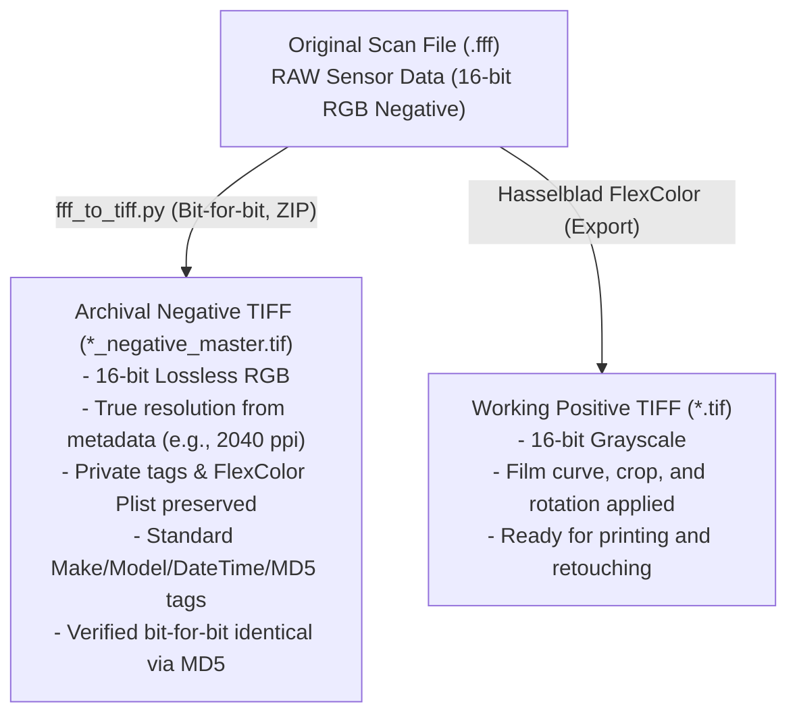

# Hasselblad / Imacon Flextight X5: FFF Analysis and Lossless TIFF Conversion

This repository documents the technical analysis of proprietary **.fff** (3F – *Flexible File Format*) files produced by the **Hasselblad / Imacon Flextight X5** virtual drum scanner for 4x5 negatives. It provides tools for their **standard lossless archiving** and for extracting the developed positive rendering from Hasselblad FlexColor.

---

## 1. Anatomy of the .fff Format (Hasselblad 3F)

Low-level inspection of the `.fff` file reveals that it is internally a standard **Big-Endian TIFF (`MM`, Magic 42)** container with the following architecture:

### Primary Image (IFD #0)
- **Resolution:** e.g., 7991 × 10120 pixels (~80.8 megapixels at 2040 ppi for 4x5 format).
- **Color space:** 3-channel RGB (even for black-and-white film).
- **Bit depth:** 16 bits per channel (samples stored as unsigned big-endian integers `>u2`).
- **Effective sensor dynamic range:** **14 native bits** padded to 16 bits (all values are exact multiples of 4; the 2 least significant bits are always `0`).
- **Raw payload:** **Uninverted negative** image data without any compression (a single continuous byte strip = W × H × 3 × 2).
- **Multi-channel data in B&W negatives:** Channels R, G, and B record slight variations from the 3-line trilinear CCD sensor (mean deviation of ~250–280 levels across channels). Directly converting the source to grayscale would discard native sensor information; the archival master must therefore remain 3-channel RGB.

### Hasselblad / Imacon Proprietary Tags and Metadata
FlexColor development parameters **do not alter the raw sensor pixels**; instead, they are recorded as non-destructive recipes within private TIFF tags:

| Tag / Directory | Name | Description |
|---|---|---|
| `33723` | **IPTC** | Standard IPTC metadata (byline/author, scan date/time, caption/title, etc.). |
| `34152` | **IPTC Copy** | Secondary copy of the IPTC block managed by Imacon. |
| `34377` | **Photoshop IRB** | Photoshop Image Resource Blocks (8BIM) containing IPTC and resolution data. |
| `46277` | **Imacon Scan Info** | Hardware scanner info, calibration, and target profiles. |
| `46279` | **Imacon Scanner ID** | FlexColor software version and scanner hardware serial number. |
| `50457` | **FlexColor Plist** | Apple Property List (XML) containing **all adjustment sets**: gradation curves, histogram, color cast removal, rotation (90°), crop, and color profiles. |
| `50458` | **Imacon RGB Thumb** | Embedded 8-bit RGB preview thumbnail. |
| *(External Directories)* | **IFD #1 / #2** | Sub-IFDs appended to the tail of the original `.fff` file containing downscaled preview thumbnails (8-bit and 16-bit). These are not replicated in the master TIFF as they are redundant (the original thumbnail is already preserved in tag `50458`). |

---

## 2. Archival Strategy: Archival Master vs. Working Positive

Proper digital preservation requires decoupling the **archival master** from the **rendered / interpreted positive**:



1. **Archival Negative TIFF (`*_negative_master.tif`)**:
   - **100% Lossless:** Raw 16-bit RGB pixel data is copied byte-for-byte without any alteration.
   - **Lossless Compression (Deflate/ZIP + Horizontal Predictor):** Reduces file size by approximately 25–30% while preserving strict bit-for-bit integrity.
   - **Long-term Compatibility:** Open and editable in any standard imaging software (Photoshop, Lightroom, RawTherapee, Negative Lab Pro), even if the FlexColor runtime environment becomes obsolete.
   - **Standard Metadata Automatically Populated:**
     - `ImageDescription` (tag 270): Records source filename, exact raw pixel MD5 checksum, effective ppi, active FlexColor setup name, and ISO conversion timestamp.
     - `Make` (tag 271): `Hasselblad`.
     - `Model` (tag 272): `Flextight X5`.
     - `DateTime` (tag 306): Original scan timestamp extracted from IPTC records `2:55` and `2:60`/`2:56`.
   - **Preserved Private Tags:** Complete byte-for-byte copy of Imacon/FlexColor blocks, including the plist `50457` holding the complete adjustment history.

2. **Working Positive TIFF (`*.tif`)**:
   - Exported directly via **FlexColor**.
   - **16-bit Grayscale** format (maximum continuous tonal range without banding/posterization).
   - Color inversion, rotation, framing crop, and custom contrast curve fully rendered.

---

## 3. Using the `fff_to_tiff.py` Script

The [`fff_to_tiff.py`](fff_to_tiff.py) script automates the conversion process with built-in safety verifications.

### Prerequisites
Install the required Python dependencies:
```powershell
pip install numpy tifffile imagecodecs pytest
```

### CLI Syntax
```powershell
# Single conversion (automatically generates NAME_negative_master.tif)
python fff_to_tiff.py "scan.fff"

# Specify a custom output file
python fff_to_tiff.py "scan.fff" -o "output_master.tif"

# Safely overwrite an existing master file
python fff_to_tiff.py "scan.fff" -o "output_master.tif" --force

# Custom strip height for compression (default: 64 rows)
python fff_to_tiff.py "scan.fff" --rows-per-strip 128
```

### Built-in Safety Features
- **Source Collision Protection:** Prevents accidental overwriting of the source `.fff` file even when specified as the destination with `--force`.
- **Two-tier Post-write Verification:** Immediately re-reads the output TIFF, compares pixel arrays against the source numpy matrix, and validates MD5 checksums.
- **Atomic Writing:** The image is written to a temporary `.tif.partial` file; if verification or writing fails for any reason (e.g., out of disk space or process interruption), the incomplete file is cleanly removed.
- **Cross-platform and Endianness Support:** Native support for both Big-Endian (`MM`) and Little-Endian (`II`) TIFF containers.
- **Zero-copy and Low Memory Footprint:** Employs `memoryview` for MD5 hashing and direct buffer passing to minimize RAM consumption when processing ultra-high-resolution large-format scans.

---

## 4. Test Suite (`pytest`)

Automated unit tests are provided in [`test_fff_to_tiff.py`](test_fff_to_tiff.py):

```powershell
python -m pytest -v
```

Included test cases:
1. `test_end_to_end_lossless_conversion`: Full round-trip verification, DPI extraction from plist, and private tag preservation.
2. `test_refuses_to_overwrite_source_file`: Confirms `--force` cannot overwrite the source `.fff` file.
3. `test_truncated_file_raises_value_error`: Detection of truncated files or out-of-bounds offsets (`_read_exact`).
4. `test_corrupt_flexcolor_plist_falls_back_gracefully`: Graceful degradation if metadata plist is malformed.
5. `test_little_endian_conversion`: Validates little-endian (`<`) byte order handling and MD5 integrity.
6. `test_partial_file_cleaned_up_on_failure`: Ensures incomplete `.partial` files are deleted on runtime exceptions.

---

## 5. License

Released under an open-source license for archiving and processing Hasselblad/Imacon Flextight scanner files.
